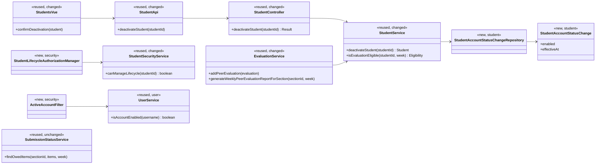
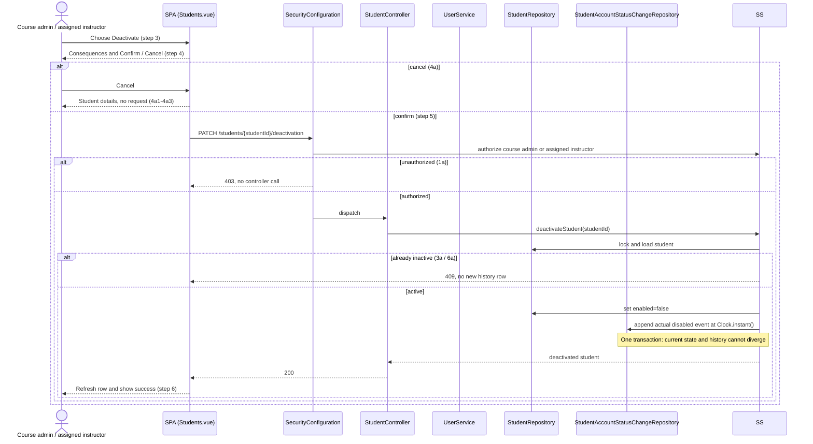
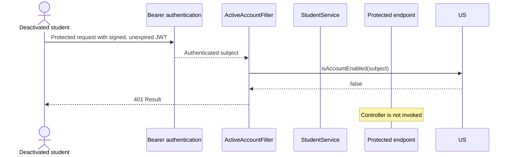
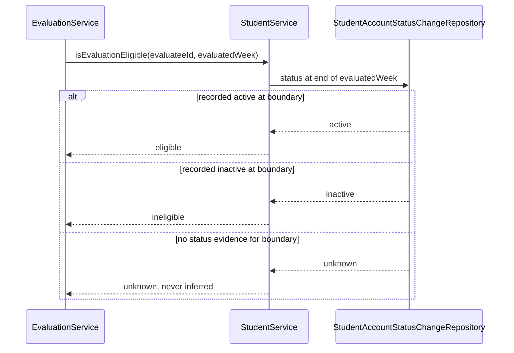
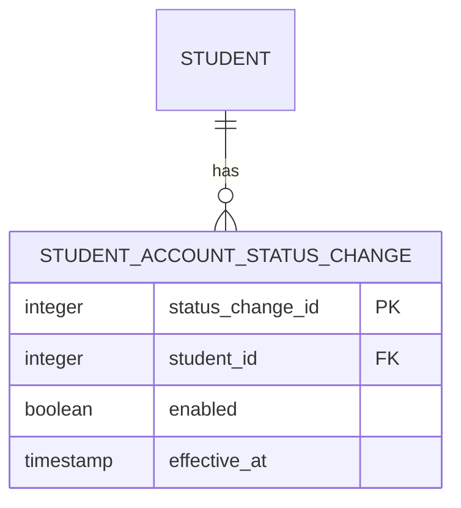

# Student (STU) Design

> Realizes: UC-STU-deactivate-student
> Depends on: FR-SEC-authentication, FR-SEC-authorization, FR-SEC-deny-unauthorized, FR-SEC-active-account, BR-student-lifecycle, BR-deactivated-student-evaluations, BR-submission-owed, BR-evaluation-submission-window
> See: [student use cases](../requirements/use-cases.md#student), [security requirements](../requirements/software-requirements-specification.md#security-and-authorization-requirements), [Business Domain Model](../requirements/software-requirements-specification.md#business-domain-model), [architectural-design.md](architectural-design.md#container-diagram)
> Designed against `main` at `59f0267` (2026-11-03).

## Overview

The existing student vertical slice remains the owner of account lifecycle changes. Deactivation moves from the generic profile update to a dedicated, authorized transition in `StudentController` and `StudentService`; the SPA exposes that transition from the student list only after a consequence-specific confirmation. The evaluation slice asks `StudentService` for historical eligibility rather than reading student persistence directly, while the security subsystem rechecks current account state for bearer-authenticated requests so an issued token cannot outlive deactivation.

## Components & classes

- **Frontend changed:** [`Students.vue`](../../frontend/src/pages/students/Students.vue) owns the dedicated action and confirmation; [`EditStudentForm.vue`](../../frontend/src/pages/students/EditStudentForm.vue) displays status without mutating it; [`apis/student`](../../frontend/src/apis/student/index.ts) adds the call.
- **Student slice changed/new:** [`StudentController`](../../backend/src/main/java/team/projectpulse/student/StudentController.java) and [`StudentService`](../../backend/src/main/java/team/projectpulse/student/StudentService.java) own the transition. `StudentAccountStatusChange` and its repository live beside them in `student/`.
- **Security changed/new:** [`SecurityConfiguration`](../../backend/src/main/java/team/projectpulse/security/SecurityConfiguration.java) adds the dedicated route rule. `StudentLifecycleAuthorizationManager` delegates the target-specific decision to [`StudentSecurityService`](../../backend/src/main/java/team/projectpulse/student/StudentSecurityService.java), admitting the student's course admin or an instructor assigned to her course section. `ActiveAccountFilter` runs after bearer authentication and before authorization for protected API requests and delegates the all-account current-state lookup to [`UserService`](../../backend/src/main/java/team/projectpulse/user/UserService.java).
- **Evaluation changed:** [`EvaluationService`](../../backend/src/main/java/team/projectpulse/evaluation/EvaluationService.java) delegates historical-status questions to `StudentService`; it does not import the new repository.
- **Notification reused:** [`SubmissionStatusService`](../../backend/src/main/java/team/projectpulse/notification/SubmissionStatusService.java) keeps using current `enabled` status for what is owed.

## Sequence

### UC-STU-deactivate-student

### Existing bearer token after deactivation

### Evaluation eligibility for a historical week

## API contract

| Endpoint | Caller (who may) | Request | Success | Errors, by extension |
|---|---|---|---|---|
| `PATCH /api/v1/students/{studentId}/deactivation` | The course admin who owns the student's course, or an instructor assigned to the student's course section (`BR-student-lifecycle`); a dedicated route guard is placed before the API `denyAll()` fallback | Path student ID; no body | `200` `Result` containing the updated student | Unauthorized instructor, student, or an unresolvable target ID: `403` (1a), before controller logic and without disclosing whether the ID exists. Already or concurrently deactivated: `409` (3a/6a), with no new history row |
| Existing `POST /api/v1/evaluations` | An active student on the evaluatee's team, under the existing route and submission-window rules | Existing evaluation request | Existing success when `StudentService` resolves the evaluatee as eligible at the end of the evaluated week | Recorded inactive at the week boundary: `400` (UC-EVA 5a). Unknown historical status: `400`; the service does not guess |
| Existing `GET /api/v1/evaluations/sections/{sectionId}/week/{week}` | Existing assigned-instructor rule | Existing week path | Existing report shape, with its student population resolved through `StudentService`; retained rows are never hidden | Existing authorization and input errors unchanged |

Cancellation (4a) is entirely client-side and sends no API request.

## Key decisions

**A dedicated transition, not profile editing.** `enabled` is removed from the generic update mutation and deactivation gets one route with one confirmation. Rejected: retaining both paths, because profile editing would bypass the warning and dedicated authorization.

**Current state plus append-only history.** `Student.enabled` remains the fast current-state field, while each real transition appends an effective-time event in the same transaction. Rejected: a single `deactivatedAt`, which cannot represent reactivation cycles. Rejected: migration-time backfill, because it would present inferred legacy status as fact.

**End-of-week eligibility.** `StudentService` resolves the evaluatee's status at the end of the evaluated ISO week. Rejected: current status alone, which would prevent finishing an evaluation for a week completed before deactivation. An unknown boundary is rejected rather than guessed; retained evaluations remain reportable evidence, but do not fabricate an account-status event.

**Immediate access denial.** A bearer-authenticated protected request rechecks current account state before authorization. Rejected: accepting the token until its two-hour expiry, which violates FR-SEC-active-account. This is active-account enforcement, not general logout or leaked-token revocation, so TD-jwt-revocation remains open.

**Target-specific authorization.** A dedicated manager resolves the target student's course admin and assigned course-section instructors and fails closed for an unknown target. Rejected: `UserOwnershipAuthorizationManager`, which also admits the student herself; rejected: role-only `ROLE_instructor`, which admits unrelated instructors.

**Conflict for a repeated transition.** The service returns `409` and appends no duplicate event when the target is already inactive. Rejected: silent success, which would hide stale UI state and concurrent deactivation.

## Data model

The shared entity is defined by the SRS [Business Domain Model](../requirements/software-requirements-specification.md#business-domain-model). The implementation delta is one append-only table, introduced by the next Flyway migration; deletion cascades with the physically deleted student.

The migration creates no history rows for existing students. Registration records the first real enabled event for new students; subsequent deactivate/reactivate transitions append events. Queries order by `effective_at` then the primary key, so two real transitions recorded at the same clock instant remain distinct. The service uses the injected `Clock` and `WeekKeys` to calculate the end-of-week boundary consistently.

## Reuse & cross-cutting

- Authentication remains the self-issued JWT mechanism; `ActiveAccountFilter` adds the current-account check required by FR-SEC-active-account.
- Authorization remains fail-closed in `SecurityConfiguration` and the `AuthorizationManager` family.
- Time uses the injected `Clock` and [`WeekKeys`](../../backend/src/main/java/team/projectpulse/system/WeekKeys.java), including ISO week boundaries.
- Errors keep the shared `Result` envelope. A small student-lifecycle conflict exception maps to `409`; ineligible or unknown evaluation status maps to the evaluation slice's existing `400` policy error.
- The architecture-of-record needs no Level-1 boundary change: `student` remains foundation, `evaluation` calls its service layer, and `security` remains the cross-cutting request gate.

## Tests

| Flow | Level | Asserts |
|---|---|---|
| UC-STU main, course admin | integration | Owner confirms; route returns `200`, disables the student, preserves team/section and submitted records, and appends one disabled event |
| UC-STU main, assigned instructor | integration | Assigned course-section instructor can perform the same transition |
| UC-STU step 4 warning | frontend component | Warning identifies the cited consequences and presents Confirm and Cancel |
| UC-STU 4a | frontend component | Cancel returns to details, sends no request, and shows no success message |
| UC-STU 1a | integration | Unrelated instructor, another course's admin, and the student receive `403`; controller is not invoked and no target data or state leaks |
| UC-STU 3a | unit and integration | Already inactive target returns `409`, remains inactive, and gains no duplicate event |
| UC-STU 6a | integration | Two authorized deactivation requests produce one transition/event; the stale request receives `409` |
| UC-STU unresolvable target | integration | Unknown ID fails closed as `403`, discloses no target existence, and creates no history |
| Generic profile update | unit and integration | A submitted `enabled` value cannot change account state |
| FR-SEC-active-account, existing token | integration | A token issued before deactivation receives `401` on its next protected request and controller logic does not execute |
| FR-SEC-active-account, active token | integration | The same filter permits an enabled account and existing protected-route behavior remains intact |
| BR-student-lifecycle retention | integration | Deactivation preserves section/team relationships, activities, and peer evaluations |
| BR-deactivated-student-evaluations, prior week | unit and integration | Deactivation in week 9 still permits an evaluation for week 8 within its window when history records active at week 8's end |
| BR-deactivated-student-evaluations, deactivation week | unit and integration | Evaluation for week 9 or a later inactive week is rejected |
| Unknown legacy status | unit and integration | No event covers the boundary: eligibility is unknown and a new evaluation is rejected without inserting inferred history |
| Historical section report | unit and integration | Eligible students and retained evaluations appear; a student inactive at the boundary with no retained evaluation is omitted |
| BR-submission-owed | existing unit/integration regression | Deactivated evaluatee is removed immediately from what active teammates owe, even while an earlier evaluation remains permitted |
| Status-history transaction | integration | A failed history insert rolls back the `enabled` change; current state and history cannot diverge |

If the repository still has no frontend unit-test harness when `/implement` begins, the two component rows become Cypress tests rather than introducing a second frontend test framework.

## Open questions / risks

- **Legacy status is unknowable.** The migration deliberately creates no inferred events. A pre-migration week may still display retained evaluations, but a new evaluation whose eligibility boundary is unknown is rejected. This is conservative and honest, but it may prevent completing one still-open evaluation immediately after deployment.
- **One account lookup per protected request.** Immediate revocation adds a database read. Course scale makes that acceptable; implementation should measure rather than add a cache that could extend revoked access.
- **Course admin coverage.** The current student security helper checks assigned instructors, not the owning course admin. The dedicated lifecycle guard must test both paths explicitly.
- **Physical deletion.** The new history rows must cascade with the existing unrecoverable student deletion so the deletion use case does not acquire an orphan constraint.
