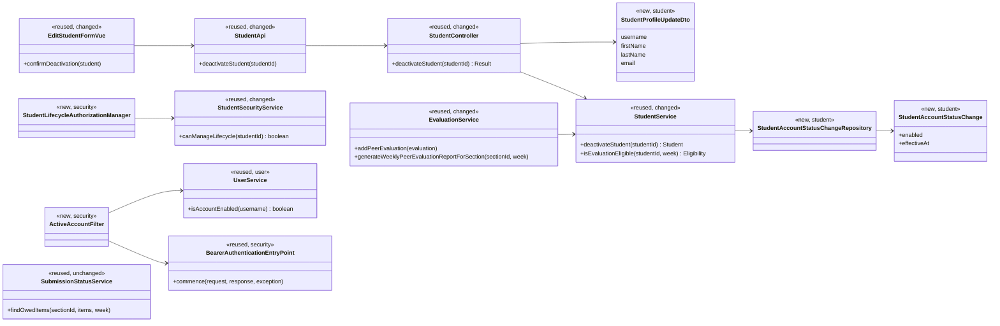
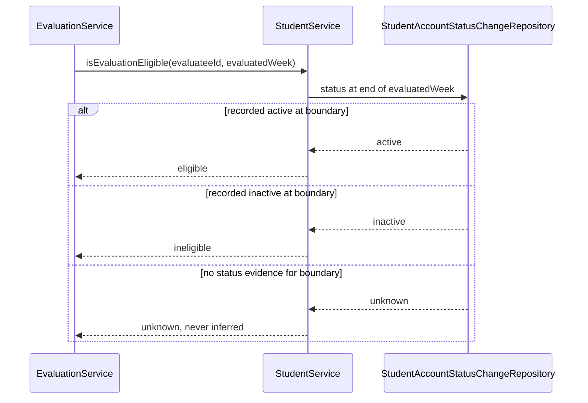
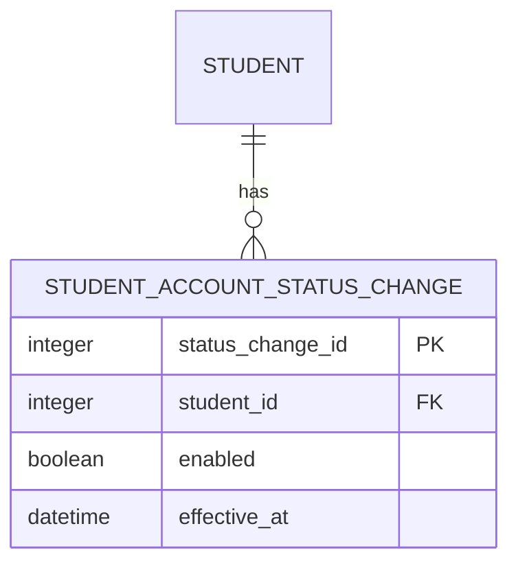

# Student (STU) Design

> Realizes: UC-STU-deactivate-student
> Depends on: FR-SEC-authentication, FR-SEC-authorization, FR-SEC-deny-unauthorized, FR-SEC-active-account, BR-student-lifecycle, BR-deactivated-student-evaluations, BR-submission-owed, BR-evaluation-submission-window
> See: [student use cases](../requirements/use-cases.md#student), [security requirements](../requirements/software-requirements-specification.md#security-and-authorization-requirements), [Business Domain Model](../requirements/software-requirements-specification.md#business-domain-model), [architectural-design.md](architectural-design.md#containers)
> Designed against `main` at `59f0267` (2026-11-03).

## Overview

The existing student vertical slice remains the owner of account lifecycle changes. Deactivation moves from the generic profile update to a dedicated, authorized transition in `StudentController` and `StudentService`; the SPA exposes that transition on the student-details view only after a consequence-specific confirmation. The evaluation slice asks `StudentService` for historical eligibility rather than reading student persistence directly, while the security subsystem rechecks current account state for bearer-authenticated requests so an issued token cannot outlive deactivation.

## Components & classes



- **Frontend changed:** [`EditStudentForm.vue`](../../frontend/src/pages/students/EditStudentForm.vue), the student-details view reached in step 2, displays status without mutating it and owns the dedicated action and confirmation; [`Students.vue`](../../frontend/src/pages/students/Students.vue) remains the route into those details; [`apis/student`](../../frontend/src/apis/student/index.ts) adds the call.
- **Student slice changed/new:** [`StudentController`](../../backend/src/main/java/team/projectpulse/student/StudentController.java) and [`StudentService`](../../backend/src/main/java/team/projectpulse/student/StudentService.java) own the transition. A writable `StudentProfileUpdateDto` replaces `StudentDto` as the generic profile-update request and carries no `enabled` field; the response DTO may still expose status. `StudentAccountStatusChange` and its repository live beside them in `student/`.
- **Security changed/new:** [`SecurityConfiguration`](../../backend/src/main/java/team/projectpulse/security/SecurityConfiguration.java) adds the dedicated route rule. `StudentLifecycleAuthorizationManager` delegates the target-specific decision to [`StudentSecurityService`](../../backend/src/main/java/team/projectpulse/student/StudentSecurityService.java), admitting the student's course admin or an instructor assigned to her course section. `ActiveAccountFilter` runs after bearer authentication and before authorization for protected API requests and delegates the all-account current-state lookup to [`UserService`](../../backend/src/main/java/team/projectpulse/user/UserService.java). On an inactive account it clears the security context and calls the existing bearer authentication entry point with a disabled-account authentication exception; it does not throw toward MVC advice from the filter chain.
- **Evaluation changed:** [`EvaluationService`](../../backend/src/main/java/team/projectpulse/evaluation/EvaluationService.java) delegates historical-status questions to `StudentService`; it does not import the new repository.
- **Notification reused:** [`SubmissionStatusService`](../../backend/src/main/java/team/projectpulse/notification/SubmissionStatusService.java) keeps using current `enabled` status for what is owed.

## Sequence

### UC-STU-deactivate-student

```mermaid
sequenceDiagram
    actor I as Course admin / assigned instructor
    participant SPA as SPA (EditStudentForm.vue)
    participant SEC as SecurityConfiguration
    participant AUTH as StudentLifecycleAuthorizationManager
    participant SC as StudentController
    participant SS as StudentService
    participant SR as StudentRepository
    participant HR as StudentAccountStatusChangeRepository

    I->>SPA: Choose Deactivate (step 3)
    SPA-->>I: Consequences and Confirm / Cancel (step 4)
    alt cancel (4a)
        I->>SPA: Cancel
        SPA-->>I: Student details, no request (4a1-4a3)
    else confirm (step 5)
        SPA->>SEC: PATCH /students/{studentId}/deactivation
        SEC->>AUTH: authorize course owner or assigned instructor
        alt unauthorized (1a)
            SEC-->>SPA: 403, no controller call
        else authorized
            SEC->>SC: dispatch
            SC->>SS: deactivateStudent(studentId)
            SS->>SR: scoped pessimistic lock and load using caller identity
            alt already inactive (3a / 6a)
                SS-->>SPA: 409, no new history row
                SPA->>SPA: Show already deactivated; refresh details
            else active
                SS->>SR: set enabled=false
                SS->>HR: append actual disabled event at LocalDateTime.now(clock)
                Note over SS,HR: One transaction: current state and history cannot diverge
                SS-->>SC: deactivated student
                SC-->>SPA: 200
                SPA-->>I: Refresh row and show success (step 6)
            end
        end
    end
```

### Existing bearer token after deactivation

```mermaid
sequenceDiagram
    actor S as Deactivated student
    participant JWT as Bearer authentication
    participant AF as ActiveAccountFilter
    participant US as UserService
    participant API as Protected endpoint

    S->>JWT: Protected request with signed, unexpired JWT
    JWT-->>AF: Authenticated subject
    AF->>US: isAccountEnabled(subject)
    US-->>AF: false
    AF->>AF: Clear SecurityContext; invoke bearer entry point
    AF-->>S: 401 Result
    Note over API: Controller is not invoked
```

### Evaluation eligibility for a historical week



## API contract

| Endpoint | Caller (who may) | Request | Success | Errors, by extension |
|---|---|---|---|---|
| `PATCH /api/v1/students/{studentId}/deactivation` | The course admin who owns the student's course (independent of section assignment), or an instructor assigned to the student's course section (`BR-student-lifecycle`); a dedicated route guard is placed before the API `denyAll()` fallback | Path student ID; no body | `200` `Result` containing the updated student | Authorization runs first. Unauthorized instructor, student, malformed/unresolvable target, or target outside caller scope: `403` (1a), before controller logic and without disclosing whether the ID exists. Only an authorized caller can receive `409` for an already or concurrently deactivated target (3a/6a), with no new history row |
| Existing `POST /api/v1/evaluations` | An active student on the evaluatee's team, under the existing route and submission-window rules | Existing evaluation request | Existing success when `StudentService` resolves the evaluatee as eligible at the end of the evaluated week | Recorded inactive at the week boundary: `400` (UC-EVA 5a). Unknown historical status: `400`; the service does not guess |
| Existing `GET /api/v1/evaluations/sections/{sectionId}/week/{week}` | Existing assigned-instructor rule | Existing week path | Existing report shape, with its student population resolved through `StudentService`; retained rows are never hidden | Existing authorization and input errors unchanged |

Cancellation (4a) is entirely client-side and sends no API request.

## Key decisions

**A dedicated transition, not profile editing.** `enabled` is absent from the writable `StudentProfileUpdateDto`, and deactivation gets one route with one confirmation. Rejected: ignoring an `enabled` field on the generic request, because a writable contract that appears to accept status is ambiguous; rejected: retaining both mutation paths, because profile editing would bypass the warning and dedicated authorization.

**Current state plus append-only history.** `Student.enabled` remains the fast current-state field, while each real transition appends an effective-time event in the same transaction. Rejected: a single `deactivatedAt`, which cannot represent reactivation cycles. Rejected: migration-time backfill, because it would present inferred legacy status as fact.

**End-of-week eligibility.** An evaluated ISO week is the half-open interval from Monday 00:00 through the following Monday 00:00 in `app.timezone`. `StudentService` selects the last status event strictly before that following-Monday boundary, ordered by `effectiveAt` then primary key; the highest primary key wins when timestamps match. No earlier event means `unknown`, never an inference from `Student.enabled`. Week-end status is authoritative: a student reactivated before the boundary is eligible for that week. Rejected: current status alone, which would prevent finishing an evaluation for a week completed before deactivation. An unknown boundary rejects creation or editing rather than guessing; retained evaluations remain reportable evidence, but do not fabricate an account-status event.

**Immediate access denial.** Login keeps Spring Security's existing `UserDetails.isEnabled()` check, so a disabled account cannot obtain a token. For an issued token, a once-per-request filter rechecks every successfully bearer-authenticated request before authorization, skipping anonymous/public requests and error redispatch; a missing or inactive subject fails closed through the bearer entry point with `401`. Rejected: accepting the token until its two-hour expiry, which violates FR-SEC-active-account. This is active-account enforcement, not general logout or leaked-token revocation, so TD-jwt-revocation remains open.

**Target-specific authorization, twice.** A dedicated manager authorizes before target state is read: it admits the owning course admin independently of section assignment, otherwise requires instructor assignment, and fails closed for malformed, unknown, or out-of-scope targets. Inside the transaction, `StudentService` reads caller scope through `UserUtils` and acquires the target with a caller-scoped pessimistic-write query; failure is the same `403`. Rejected: `UserOwnershipAuthorizationManager`, which also admits the student herself; rejected: role-only `ROLE_instructor`, which admits unrelated instructors; rejected: an unscoped service load that makes the route guard the only barrier.

**Conflict for a repeated transition.** The service returns `409` and appends no duplicate event when the authorized target is already inactive. A pessimistic write lock serializes concurrent transitions. The SPA shows an informational "already deactivated" message, refreshes the details, and stays on that view. Rejected: silent success, which would hide stale UI state and concurrent deactivation.

**Warning content.** Without prescribing verbatim copy, the confirmation names immediate loss of access (including existing credentials), retained course-section/team assignments and submitted work, optional earlier-week evaluation eligibility, removal from current submission obligations, later reactivation, and the distinction from permanent deletion. Omitting any cited consequence would make step 4 incomplete.

**Required, optional, and historical populations.** Current inactive status removes the student immediately from owed/reminder results as a submitter and removes her from teammates' required targets. When history proves an earlier week eligible and its window is open, she remains an optional evaluation target. A historical section report uses the union of students proven active at the boundary and students with retained evaluations for that week; inactive or unknown students with no retained row are omitted.

## Data model

The shared entity is defined by the SRS [Business Domain Model](../requirements/software-requirements-specification.md#business-domain-model). The implementation delta is one append-only table, introduced by the next Flyway migration; deletion cascades with the physically deleted student.



The migration creates no history rows for existing students. Registration records the first real enabled event for new students; this use case appends the disabled event in the same transaction as deactivation. A future reactivation implementation must append its enabled event in the same transaction, as the SRS requires, but reactivation code is not part of this build. `effective_at` is a `LocalDateTime` produced by the injected calendar `Clock` in `app.timezone`, matching the architecture's time convention. Queries use the strict next-Monday boundary and order by `effective_at` then primary key, so two real transitions recorded at the same clock time remain distinct.

## Reuse & cross-cutting

- Authentication remains the self-issued JWT mechanism; `ActiveAccountFilter` adds the current-account check required by FR-SEC-active-account.
- Authorization remains fail-closed in `SecurityConfiguration` and the `AuthorizationManager` family.
- Time uses the injected `Clock` and [`WeekKeys`](../../backend/src/main/java/team/projectpulse/system/WeekKeys.java), including ISO week boundaries.
- Errors keep the shared `Result` envelope. The active-account filter invokes the existing bearer entry point directly because MVC advice cannot translate an exception raised after bearer authentication in the filter chain. A small student-lifecycle conflict exception maps to `409`; ineligible or unknown evaluation status maps to the evaluation slice's existing `400` policy error.
- The architecture-of-record needs no Level-1 boundary change: `student` remains foundation, `evaluation` calls its service layer, and `security` remains the cross-cutting request gate.

## Tests

| Flow | Level | Asserts |
|---|---|---|
| UC-STU main, course admin | integration | Owner confirms; route returns `200`, disables the student, preserves team/section and submitted records, and appends one disabled event |
| UC-STU main, assigned instructor | integration | Assigned course-section instructor can perform the same transition |
| UC-STU step 4 warning | E2E (Cypress) | Student-details warning identifies every required consequence and presents Confirm and Cancel |
| UC-STU 4a | E2E (Cypress) | Cancel returns to details, sends no request, and shows no success message |
| UC-STU 1a | integration | Unrelated instructor, another course's admin, and the student receive `403`; controller is not invoked and no target data or state leaks |
| UC-STU 3a | unit and integration | Already inactive target returns `409`, remains inactive, and gains no duplicate event |
| UC-STU 6a | integration | Two authorized requests run sequentially: the first produces one transition/event, and the stale second request receives `409` without adding another event |
| UC-STU 6a, stale UI | E2E (Cypress) | `409` shows already-deactivated information, refreshes the details, and stays on the details view |
| UC-STU unresolvable target | integration | Unknown ID fails closed as `403`, discloses no target existence, and creates no history |
| Generic profile update | unit and integration | A submitted `enabled` value cannot change account state |
| FR-SEC-active-account, existing token | integration | A token issued before deactivation receives `401` on its next protected request and controller logic does not execute |
| FR-SEC-active-account, active token | integration | The same filter permits an enabled account and existing protected-route behavior remains intact |
| FR-SEC-active-account, disabled login | integration | A disabled account cannot authenticate or receive a new token |
| BR-student-lifecycle retention | integration | Deactivation preserves section/team relationships, activities, and peer evaluations |
| BR-deactivated-student-evaluations, prior week | unit and integration | Deactivation in week 9 still permits an evaluation for week 8 within its window when history records active at week 8's end |
| BR-deactivated-student-evaluations, deactivation week | unit and integration | Evaluation for week 9 or a later inactive week is rejected |
| BR-deactivated-student-evaluations, boundary | unit | The last event strictly before next Monday controls eligibility; an event exactly at Monday belongs to the new week; equal timestamps use the highest primary key |
| Unknown legacy status | unit and integration | No event covers the boundary: eligibility is unknown and a new evaluation is rejected without inserting inferred history |
| Unknown legacy status, retained edit | unit and integration | A retained evaluation remains visible, but creation or editing is rejected when eligibility is unknown |
| Historical section report | unit and integration | Eligible students and retained evaluations appear; a student inactive at the boundary with no retained evaluation is omitted |
| BR-submission-owed | existing unit/integration regression | The inactive student owes no WAR/evaluation and is absent from reminders; active teammates do not owe her an evaluation, even while an earlier evaluation remains optional |
| Status-history transaction | integration | A failed history insert rolls back the `enabled` change; current state and history cannot diverge |

The frontend rows use the repository's existing Cypress setup; `/implement` does not introduce a second frontend test framework.

## Open questions / risks

- **Legacy status is unknowable.** The migration deliberately creates no inferred events. A pre-migration week may still display retained evaluations, but a new evaluation whose eligibility boundary is unknown is rejected. This is conservative and honest, but it may prevent completing one still-open evaluation immediately after deployment.
- **One account lookup per protected request.** Immediate revocation adds a database read. Course scale makes that acceptable; implementation should measure rather than add a cache that could extend revoked access.
- **Course admin coverage.** The current student security helper checks assigned instructors, not the owning course admin. The dedicated lifecycle guard must test both paths explicitly.
- **Physical deletion.** The new history rows must cascade with the existing unrecoverable student deletion so the deletion use case does not acquire an orphan constraint.
